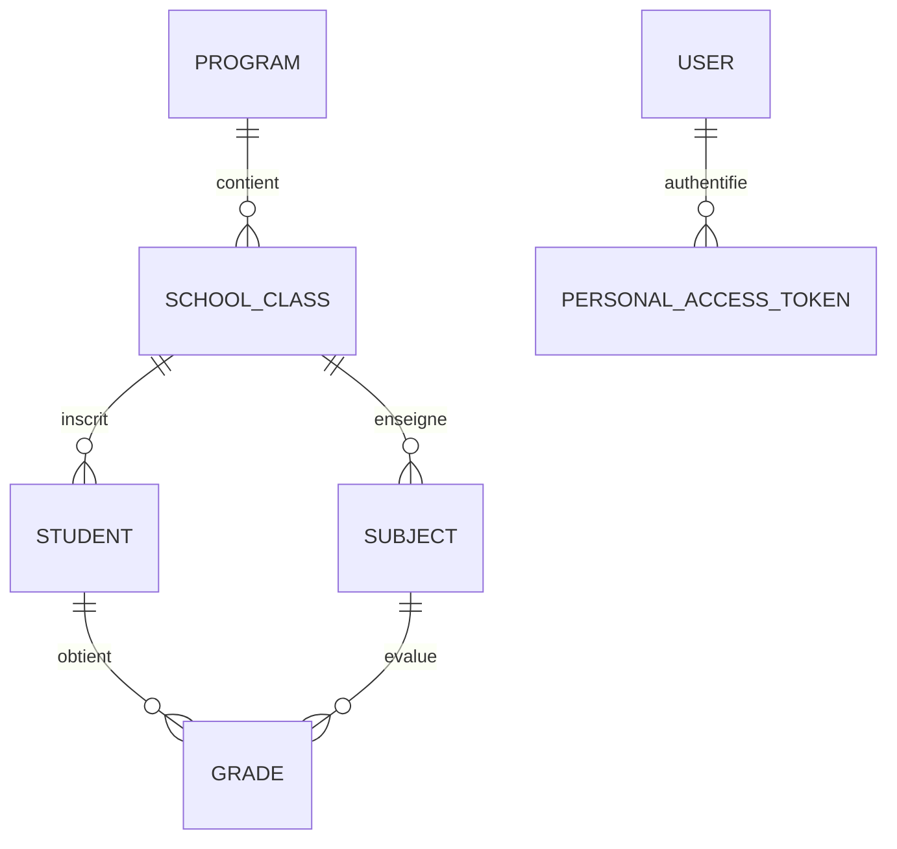
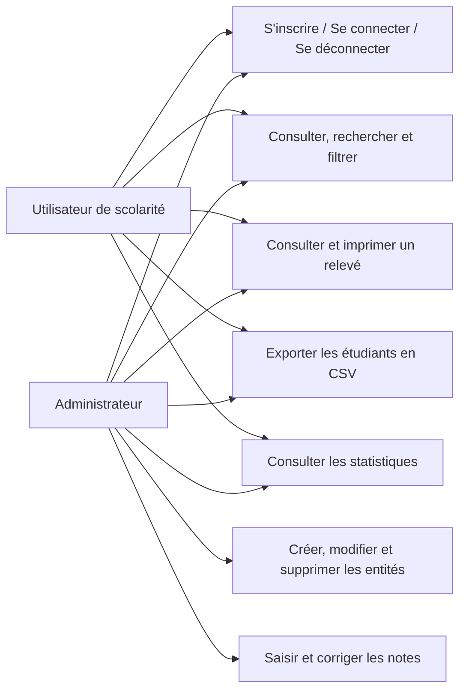

# Conception — Groupe 1

## Modèle conceptuel

L’utilisateur est un membre du personnel de scolarité, indépendant de la fiche étudiant. Ses droits proviennent de son rôle. Une classe représente un groupe pour une année académique ; les matières et inscriptions appartiennent à cette classe.

## Modèle logique

| Table | Clé primaire | Attributs métier et contraintes |
| --- | --- | --- |
| users | id | name, email unique, password haché, role (`admin` ou `user`) |
| programs | id | name, code unique, description nullable |
| school_classes | id | program_id FK, name, academic_year ; triplet unique |
| students | id | school_class_id FK, registration_number unique, first_name, last_name, email unique nullable, phone, birth_date, status |
| subjects | id | school_class_id FK, name, code unique, coefficient positif |
| grades | id | student_id FK, subject_id FK, assessment, score 0..20, weight positif ; triplet étudiant/matière/évaluation unique |
| personal_access_tokens | id | token haché, relation polymorphe utilisateur, expires_at |

Toutes les tables métier ont des dates de création et de modification. Les contraintes d’unicité et les clés étrangères sont définies dans les migrations ; la validation applicative ajoute les bornes métier et la cohérence des classes. Une suppression étudiant entraîne celle de ses notes ; les autres références bloquent la suppression.

## Cas d’utilisation

## Choix techniques

Laravel organise l’API et fournit validation, hachage, Eloquent et migrations. Sanctum gère les jetons révocables. MySQL est la cible relationnelle du TP ; SQLite permet de lancer la démonstration et de tester sans service externe. React sépare l’interface de l’API ; MUI apporte formulaires, dialogues et tables cohérents. Vite fournit la compilation et le proxy `/api`.

Les moyennes sont calculées à la demande, sans colonne de moyenne stockée susceptible de devenir obsolète. Les matières non notées sont identifiées et le relevé reste provisoire.
